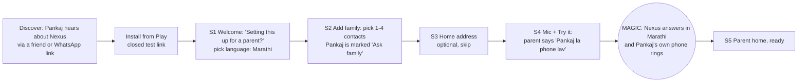
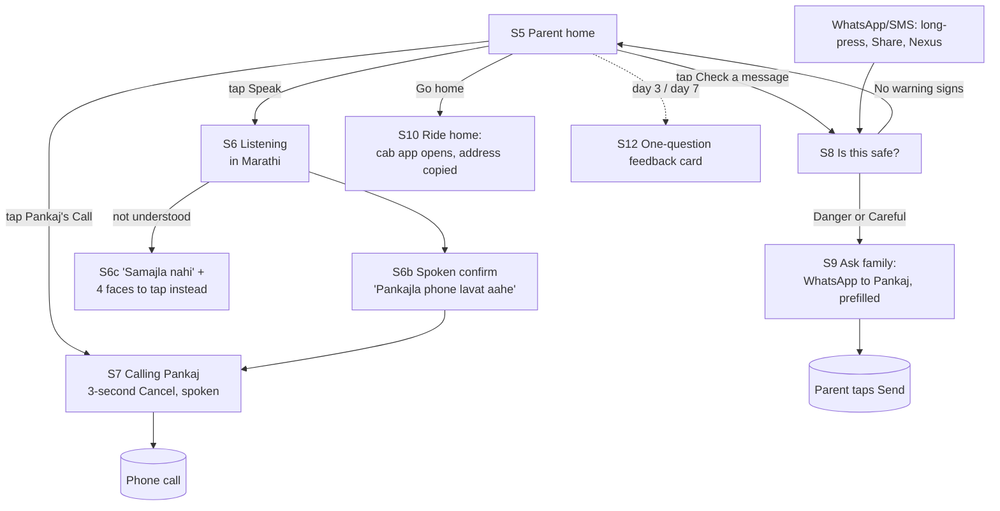

# Nexus design document: parent mode revamp (Phase 1)

Date: 2026-11-10. Author: Founder CEO (Grok Bot) for Pankaj Khannade.
Base: commit `7fd6d17`, `android/` (Kotlin, Jetpack Compose, Material 3, minSdk 26, targetSdk 35).
Reads with: `docs/vision-phases.md` (vision and phases), `docs/evaluation-2026-11-10.md` (bug teardown), `docs/decisions.md`.
Status: proposal. Static code read only, nothing tested on a phone yet. The Hindi and Marathi copy is a first draft and needs review by a native speaker before testers see it.

---

## 0. The point in one paragraph

Today's UI is a commuter's power tool: one long scrolling screen with places, people, a text box, a Sample button, a theme toggle and a 3-card tour, all in 14-16sp English. The vision's daily user is a 65-year-old parent on a Rs 10-25k phone who speaks Hindi or Marathi. For that person, the app should be one screen of family faces with one huge Speak button. It answers out loud in their language, and when something looks risky, the safe action ("Ask Pankaj") is the biggest button on screen. The child sets everything up on the parent's phone in under 3 minutes. Setup ends with the magic moment: the parent says "Pankaj la phone lav", Nexus replies in Marathi, and the child's own phone rings in their hand.

---

## 1. Critical evaluation of the current UI/UX

Files read: `App.kt` (63 lines), `MainActivity.kt` (106), `SetupScreen.kt` (260), `HomeScreen.kt` (436), `Theme.kt` (58), `Model.kt`, `Plan.kt`, `Actions.kt`, `AndroidManifest.xml`, `res/values/strings.xml`, `res/values/themes.xml`.
There's no separate permissions-explainer screen. The only explainer is a branch inside `ContactsDialog` (`HomeScreen.kt:320-352`).

### 1.1 Top 5 problems (ranked by harm to a 65-year-old)

| # | Problem | Evidence | Why it breaks the vision |
|---|---|---|---|
| 1 | **English only, everywhere, hard-coded** | `strings.xml` holds only `app_name`. Every string is a literal in Kotlin (e.g. `HomeScreen.kt:90, 94, 102, 111, 116, 128, 129`; `SetupScreen.kt:55-57, 86-87, 194`). Voice is locked to `en-IN` (`HomeScreen.kt:124`). | The parent speaks Hindi or Marathi. Nexus can't be translated without moving every string into resources, and the voice can't hear "Aai la phone kar". |
| 2 | **Text and buttons are too small** | `Theme.kt:46-53`: `labelLarge` 14sp (every Button label), `bodyMedium` 14sp, `bodyLarge` and `titleMedium` 16sp. M3 `Button` draws 40dp tall. Only one button is raised to 48dp (`SetupScreen.kt:241-243`). Place suggestions are 14sp rows (`SetupScreen.kt:169`). | NN/g and a systematic review of 40 studies of over-60 users both say large text and large, well-spaced targets matter most. 14sp labels on a cheap 6.5" phone read like fine print. |
| 3 | **You can't see what's tappable** | Card `#FFFCF8` on paper `#F7F4EF` is **1.07:1** (`Theme.kt:14-15`). The outline `#E6DFD4` on paper is **1.21:1** (`Theme.kt:17, 29`), so every `OutlinedButton` (Speak, Sample, Edit, Back, Light/Dark) and every `OutlinedTextField` border is nearly invisible. Dark mode is no better: surface on background is 1.08:1 and the outline is 1.38:1 (`Theme.kt:38, 42`). | WCAG 1.4.11 needs 3:1 for UI boundaries. Older users "need clear boundaries between touchable and non-touchable" (PMC systematic review). Text contrast is fine (muted 6.95:1); the edges are what fail. |
| 4 | **Calling family takes 3+ taps through English dialogs** | People are text rows showing name plus raw phone, with no face or initial and no Call button (`HomeScreen.kt:106-108, 228-239`). A tap opens `PersonDialog` with 4 equal-weight buttons: Call, WhatsApp, Text, Cancel (`HomeScreen.kt:304-318`). Call then opens the dialer (`ACTION_DIAL`, `Actions.kt:35-38`), which needs another green tap. SMS and WhatsApp prefill "On my way." (`HomeScreen.kt:182-183`). | The parent's #1 job is "call my son", and it costs 3 taps, an English choice and a second app. "On my way." is a commuter's message, not a parent's. |
| 5 | **Setup is a commuter form, not a child-assisted family setup** | 3 steps: (a) a country step with a 35-item dropdown in 16sp text rows (`SetupScreen.kt:83-109`), labelled "Country of residence. Local numbers use this dial code." (b) **Both** Home and Office are mandatory: "Add both addresses." (`SetupScreen.kt:127`). (c) A 5×2 grid of 10 half-width fields with placeholder-only labels ("Name", "Optional", "Phone") that vanish on typing (`SetupScreen.kt:201-218`), with no phone keypad and no relationship or nickname. Then a 3-card tour pops up right away (`HomeScreen.kt:212-214, 354-379`). | Retired parents often have no office, so they hit a wall at step 2. The form can't capture "Aai calls him Bablu", who the child is, or the parent's language. Nothing says "a family member is setting this up for someone". |

### 1.2 Full problem list, by file

**HomeScreen.kt**
- `:80-88` The header has "Light/Dark" and "Privacy" as small `TextButton`s. A theme toggle is noise for a parent, and one stray tap flips the whole app dark.
- `:89-92` "One action at a time. You confirm the fare, the call, or the message in the other app." is jargon ("action", "fare", "other app") in muted grey.
- `:94-109` One scrolling column mixes four jobs: Where to, People, Edit, Message. There's no single primary action, and on a 720p phone the People section sits below the fold.
- `:95-100` Home and Office sit at the top, which is commuter framing. If Office is blank, tapping it silently opens the edit dialog.
- `:107` A person row shows the raw stored number (`item.phone`). With the normaliser bug in `Model.kt:79-88`, that can be a wrong `+91…` number.
- `:109` "Edit people and places" is a full-width button any parent can tap, and `:404` "Remove" deletes a person **instantly, with no confirm or undo**.
- `:112-118` A 3-line text field is the main input. Typing is the hardest input for this user. The placeholder disappears on focus.
- `:119-130` "Speak" and "Sample" are equal-width, equal-weight outlined buttons. "Sample" (`:41-42, 129`) is a developer demo affordance in a user build.
- `:124` `RecognizerIntent` with `en-IN` only, no listening feedback inside Nexus, and no spoken reply.
- `:125` A failure shows "Speech recognition is not available." as a grey line far down the page (`:155-157`). Errors and notices share one muted style.
- `:65` When contacts permission is denied, the notice says "Contacts permission was not granted." with no recovery path.
- `:250-269` `MessageCard` shows "Found" and "No place", which are system words, not human ones.
- `:282-299` `RideDialog` has 5 buttons (3 cab apps, Maps, Cancel). "Open one app. You confirm the fare there." The tour copy (`:358`) promises "with that address filled in", which is false today (see evaluation item 1).
- `:329-351` `ContactsDialog` puts matches in `TextButton`s with name and raw number on one line (`:341`), and uses an `AlertDialog` with small text buttons ("Continue", "Not now").
- `:354-379` A 3-step modal tour ("Tour 1 of 3", Skip/Next) right after setup. Tours for older adults should be in context, not a carousel up front.
- `:391-421` `EditDialog` is a scrolling dialog with fields inside a dialog. Save writes both places at once (`:410-413`), and Close vs Save is ambiguous.
- `:423-433` A contact picked here is saved raw with no country code (evaluation item 3), so WhatsApp fails.

**SetupScreen.kt**
- `:55-57` "FIRST TIME" eyebrow in caps, plus "Step 1 of 3" as text only, with no progress bar.
- `:83-109` The country `DropdownMenu` uses clickable `Text` rows instead of `DropdownMenuItem`, so no ripple, no role semantics and a small target. India could be inferred from the SIM or locale.
- `:121-131` Home and Office are both required. Office should not exist in parent mode.
- `:138-148` ArcGIS suggestions fail silently offline (`getOrDefault(emptyList())`), with no "can't search right now, type the full address" state. Typed text also leaves the phone with no disclosure at this point (the privacy screen mentions it only later).
- `:189` Picking a contact when all 5 rows are full overwrites row 0 without warning.
- `:203-217` Two `OutlinedTextField`s side by side are about 150dp each on a 360dp phone, so names truncate. No `KeyboardOptions(keyboardType = Phone)`. Placeholder-only labels.
- `:219, 221` Error text shows per row *and* again at the bottom. The first error wins, with no focus jump.
- `:76-78` "Back" is a full-width outlined button under the primary, the same size as Continue, so it's easy to hit by mistake.
- Nowhere: parent language, "who is this phone for", the child's own number as an "Ask family" contact, nickname or spoken-name aliases, or a microphone check.

**Theme.kt**
- `:46-53` The type scale tops out at 28sp, with body at 14-16sp and button labels at 14sp. No `lineHeight` is set. Devanagari matras need about 1.4-1.5× line height or they clip.
- `:13-18` Only one semantic colour (`Danger`). There are no tokens for call (go), warning or no-warning, and no focus colour. The primary is near-black ink, so primary vs secondary relies on fill only.
- `:33-44` A full dark scheme exists, but its boundaries fail just as the light ones do. Parent mode doesn't need a user-facing dark toggle.

**App.kt / MainActivity.kt / manifest**
- `App.kt:35` Loading is a bare spinner with no text.
- `App.kt:51-63` Privacy is one wall of muted English text with a small "Back" text button.
- `MainActivity.kt:101-105` and `AndroidManifest.xml:47` Share accepts `text/plain` only, so screenshots (the most common way a parent sees a scam) can't be shared to Nexus. Shared text silently lands in the draft box with no "What do you want to do?".
- `AndroidManifest.xml:5` `READ_CONTACTS` is requested at runtime for name lookup. `ACTION_PICK` (already used) needs no permission, so parent mode should drop the runtime ask.

**What a 65-year-old would get stuck on (walkthrough)**
1. A country dropdown: "residence? dial code?" They give up, or tap India by luck.
2. Office is required, but they don't have one. Dead end.
3. Ten tiny boxes, and typing a 10-digit number on a QWERTY keyboard.
4. A tour carousel. They tap Skip, or tap outside and it's gone forever.
5. The home screen doesn't show their son's face, so they scroll.
6. They tap the son's name, get 4 English buttons and pick Call. The dialer opens and they wait, because the call hasn't started.
7. They tap Speak and say "Pankaj ko phone lagao". `en-IN` mis-hears it, and "Found / No place" means nothing to them.

---

## 2. Research: proven patterns

### 2.1 Mobbin references (iOS catalogue; patterns transfer to Android)

| Pattern | Reference | What we take |
|---|---|---|
| Favourite people as big faces above everything | [Genie "Pin your favorites"](https://mobbin.com/screens/3d96228c-a764-41be-b2c8-bc31d060eee3) | Top family as large avatars with names, and one plain sentence of explanation. |
| One person with two equal, labelled actions | [TextNow contact](https://mobbin.com/screens/4e721c87-a0e3-43cf-b840-3476ab308259) | Call and Message as two big icon+word buttons under the name. |
| Ask about contacts honestly, pick-only | [Apple Invites contacts](https://mobbin.com/screens/d23a2dc2-ae02-440b-b33a-ab0f558c9219) | Explain first and offer "pick the ones you want". We use the system picker (`ACTION_PICK`), which needs no permission. |
| Listening state = one word + one mic + one X | [Microsoft Copilot](https://mobbin.com/screens/dde18761-b196-4a1d-919e-10fbe3421871), [Google](https://mobbin.com/screens/6446a9af-3532-4ed8-b83f-614e6963d748), [Roku](https://mobbin.com/screens/9fc48322-f53d-463a-bde8-f2a5a92825d3) | A full-screen calm state, "Listening…" in the parent's language, a pulsing mic and one Cancel. We add a live transcript and a spoken reply. |
| Warn with icon + 3 plain bullets + one clear action | [Coinbase "Before you send"](https://mobbin.com/screens/063f1aad-dc7a-4b45-96bf-dae60b56ac66) | The verdict screen structure. |
| Make the safe action primary | [Zing "This could be a scam… Stop this payment"](https://mobbin.com/screens/10181984-fade-48f5-96e9-0863cac27cea) | "Ask Pankaj" is the big button and the risky path isn't offered at all. |
| Anti-pattern: wall of warning text | [Binance scam warning](https://mobbin.com/screens/b68d5283-5730-422d-b607-cf9e992a4b0d) | Never ship a paragraph warning: max 3 bullets of 8 words or fewer. |
| Family member tiles with a "+ New" tile | [Amazon Family flow](https://mobbin.com/flows/c6fb92d3-f77d-40f8-91f8-80437d9fc498), [Apple Wallet "Choose person"](https://mobbin.com/flows/d1cc3e8a-a458-43dd-ad94-34c9e799892e) | The setup "Add family" grid: up to 4 tiles, each with a face, name and relation, and an empty "+ Add" tile. |

### 2.2 Accessibility and older-adult guidance

- **Touch targets:** at least 48×48dp (about 9mm) with 8dp or more between targets. Android's recommended range is 7-10mm. ([Android touch target size](https://support.google.com/accessibility/android/answer/7101858), [Compose API defaults](https://developer.android.com/develop/ui/compose/accessibility/api-defaults)). A study of 40 older adults found that **target size**, not spacing, drove accuracy and speed, and supports targets of about 14-17.5mm ([Leitão & Silva, doi:10.5555/2821679.2831275](https://doi.org/10.5555/2821679.2831275)). **Our parent-mode minimum is 64dp (about 12mm), and primary actions are 72-96dp.**
- **Font scaling:** Android 14+ scales fonts nonlinearly up to 200%. Use `sp` for text and line height, never fixed heights, and test at 200% ([Android 14 features](https://developer.android.com/about/versions/14/features), [Text scaling](https://support.google.com/accessibility/android/answer/12159181)).
- **Older adults:** 123 participants aged 65+ complained about small, light text and tiny targets ([NN/g](https://www.nngroup.com/articles/usability-for-senior-citizens/)). A systematic review of 40 usability studies found two cross-cutting rules: **Simplify**, and **Increase size and spacing of controls**, plus "clearly show which elements are touchable" ([PMC10557006](https://pmc.ncbi.nlm.nih.gov/articles/PMC10557006/)).
- **Contrast:** WCAG 2.2 asks 4.5:1 for body text (we target 7:1, AAA) and 3:1 for UI component boundaries (SC 1.4.11).
- **Voice on device:** `SpeechRecognizer.createOnDeviceSpeechRecognizer` plus `checkRecognitionSupport` / `triggerModelDownload` (API 31/33). Support depends on the device: `hi-IN` is commonly available on-device, **`mr-IN` on-device is likely not**, and the default recognizer "is likely to stream audio to remote servers" ([SpeechRecognizer](https://developer.android.com/reference/android/speech/SpeechRecognizer), [RecognitionSupport](https://developer.android.com/reference/android/speech/RecognitionSupport), [expo-speech-recognition #105](https://github.com/jamsch/expo-speech-recognition/issues/105)). **Design consequence:** copy must never claim "your voice stays on the phone" unless the on-device path is active. See S4.

### 2.3 Existing elder launchers: what they get right and what users complain about

- **BIG Launcher** (2M+ downloads): large icons and fonts, spoken labels on long-press, and edit lock. Complaints: setup is "complicated and illogical" ([Stiftung Warentest](https://www.test.de/Smartphones-seniorentauglich-machen-Vier-Apps-im-Test-5121576-0/)). It needs separate paid BIG Phone and BIG SMS apps, with history limited unless you pay ([svetandroida](https://www.svetandroida.cz/big-launcher-pro-seniory-android/)). Settings are "too simplistic… a pain for the person doing housekeeping" ([Reddit](https://www.reddit.com/r/androidapps/comments/1nhog9x/launcher_for_old_folk_anyone_used_this_big/)). Large fonts aren't applied everywhere, e.g. adding a contact drops to the system UI ([AFB AccessWorld](https://afb.org/aw/14/11/15740)).
- **Samsung Easy mode** (free, built in): bigger items, a high-contrast keyboard, a longer touch-and-hold delay against accidental taps, and a quick-contacts speed-dial page ([Samsung](https://www.samsung.com/us/support/answer/ANS10001572/), [Tom's Guide](https://www.tomsguide.com/phones/samsung-phones/your-samsung-galaxy-phone-comes-with-a-hidden-easy-mode-heres-how-to-find-it)). It's Samsung-only, English and system-locale only, and has no voice-first flow, no scam help and no family loop.
- **Simple Launcher:** free, with an SOS button and edit lock. Users complain about limited customisation and "navigation confusion after swiping up" ([Play listing](https://play.google.com/store/apps/details?id=com.tct.simplelauncher), [AirDroid roundup](https://www.airdroid.com/remote-control/launcher-for-elderly/)).

**Lessons for Nexus:**
1. Big buttons are table stakes, since Samsung gives them away free. They can't be the product.
2. The gap is **voice in their language + a family safety loop + setup the child can finish without reading a manual**.
3. Keep the parent surface tiny, and give the child a real settings area (BIG Launcher's housekeeping pain).
4. Large type must apply on every screen, including edit and error screens (AFB's complaint).
5. Don't replace the launcher in Phase 1 (that's Phase 2, optional). Navigation confusion is where launchers lose people.

---

## 3. The revamp

### 3.1 Design principles

1. **One screen, one job, one big button.** Every parent screen has exactly one primary action, at least 72dp tall, placed at the bottom within thumb reach. Secondary actions are fewer than 3.
2. **Their language, out loud.** Every parent-facing string exists in Hindi, Marathi and English. Every action is confirmed by voice (TextToSpeech) *and* in large text. Icons always come with a word, never alone.
3. **Faces, not fields.** People appear as a photo or big initial with the name the parent uses ("Pankaj", "Aai", "Bablu"), never as phone numbers.
4. **The safe path is the easy path.** When something looks risky, the biggest button is "Ask Pankaj". Nexus never says "Safe", only "No warning signs found", so it never gives false comfort.
5. **The child sets up, the parent just uses.** Setup, editing and data live in Family settings, behind a 2-second hold. The parent can't delete a person by accident.
6. **Nothing leaves the phone without a visible reason.** Any network use (online speech, place search) is named on screen when it happens. Usage data leaves only when someone taps Share.
7. **Forgiving by default.** Every irreversible step has a 3-second Cancel or an Undo. Every error says what happened and the next tap to fix it, in the parent's language.

These seven are the original rules. Since 2026-11-11 the standard is the 19 principles in **3.8**; every new screen and every review is checked against them.

### 3.2 User journeys

#### Child-assisted setup (child on the parent's phone, target under 3 minutes)



#### Parent daily use



| Stage | Child | Parent | Delight target | Measured by (local counters) |
|---|---|---|---|---|
| Discover | Hears that "parents can call you by just saying it, in Marathi" | — | A clear promise in one line | — |
| Set up | S1-S4, under 3 min, no typing for picked contacts | Watches and says one sentence | "That was it?" | `setup_seconds`, `setup_completed` |
| First value | Their phone rings | Hears Nexus speak Marathi back | **The magic moment** | `first_voice_success` |
| Come back | Gets calls without first "how do I call you" calls | Taps faces or says names daily | "Easier than the phone app" | `opens/day`, `calls`, `voice_commands` |
| Ask family | Gets "Is this real?" plus the message on WhatsApp | Shares a weird message and taps Ask | "I wasn't fooled, and I wasn't embarrassed to ask" | `safety_checks`, `ask_family_taps` |
| Refer | Tells siblings and friends ("set it up for your mom") | Shows friends at the temple or park | — | Day-7 export, verbal |

**The one magical moment.** It happens at the end of setup, with the child standing beside them. The parent presses the big mic and says in their own words and language "Pankaj la phone lav". Nexus answers out loud in Marathi, "पंकजला फोन लावत आहे", and **the phone in Pankaj's hand starts ringing**. Both people feel it at once. The parent learns the whole product (just say it) in 5 seconds, and the child sees why to pay. Every setup decision serves getting to this moment fast and reliably. That means saving a spoken alias per person, falling back to tapping a face, and checking `mr-IN` support before promising voice.

(The "Ask family" save is the second, rarer moment: it earns the payment, but it can't be the first one because it depends on a scam showing up.)

### 3.3 Screen-by-screen spec (Phase 1)

Conventions:
- **P** = parent-facing: parent type scale, 64dp minimum targets, parent language.
- **C** = child-facing: child scale, 48dp minimum, English UI with a parent-language preview.
- All copy is in `res/values/strings.xml` (en), `values-hi/`, and `values-mr/`.
- The parent's language is applied per-app via `AppCompatDelegate.setApplicationLocales` (Android 13+ per-app language; AppCompat back-port for 26+).

#### S1 Welcome and language (C, then P preview)
- **Layout:** the app name, one line "Set up Nexus for your parent. Takes 2 minutes.", and three big `OutlinedCard`s for language (मराठी / हिंदी / English). Each card shows a sample phrase in that language and a speaker icon that plays it via TTS. A primary button at the bottom: "Continue". A text link: "Setting it up for yourself?" (it follows the same flow).
- **Components:** `Scaffold`, `LinearProgressIndicator` (step 1 of 4), a selectable `OutlinedCard` (2dp border, selected = 3dp primary border + check icon), `Button`.
- **States:** If the TTS voice for the language is missing, a warning row says "Marathi voice not installed on this phone. Install it (1 tap)" and opens `TextToSpeech.Engine.ACTION_INSTALL_TTS_DATA`. If the user skips, the screen still works with text only.
- **Accessibility:** cards use `Role.RadioButton` and `selectableGroup`, and the sample phrase is a `contentDescription`.
- **Removed:** the country step. Country comes from `TelephonyManager.simCountryIso` and then the locale, defaulting to India, and can be changed in Family settings.

#### S2 Add family (C)
- **Layout:** title "Who does she call most?" (copy adapts to "he/they"), with a 2×2 grid of `PersonTile`s. An empty tile shows "+ Add". Tapping it opens the **system contact picker** (`ACTION_PICK`, no permission needed). On return, a bottom sheet shows the details:
  - Name as Aai says it (prefilled, editable)
  - Relation chips (Son, Daughter, Husband/Wife, Other)
  - A toggle: "Send 'Ask family' messages to this person"
  - A mic button, "Let Aai say this name", which records a voice alias (stored as recognised text)
- **Manual entry:** a "Type a number instead" link opens two **stacked** full-width fields with real labels and a phone keypad (`KeyboardType.Phone`). They validate on blur through the single normaliser.
- **States:** At least 1 person is required, and at least one must be marked "Ask family"; Continue stays disabled with a reason line until then. If the picked contact has several numbers, the user picks one (radio list, mobile first). The duplicate number error says "Already added as Pankaj". With 4 people, the "+ Add" tile hides.
- **Copy:** EN "Add up to 4 people. You can change this later in Family settings."

#### S3 Home address (C, optional)
- **Layout:** "Add home for 'Book a ride home' (optional)". One labelled field with place suggestions, plus "Use this phone's location" (needs the coarse+fine location permission, explained first). **Skip** is a full-width secondary button.
- **States:**
  - Offline or suggestion failure: "Can't search right now. Type the full address; it'll still work."
  - Network disclosure beneath the field: "Search sends what you type to a map service."
  - A result needs lat/lng. Without coordinates, the ride is labelled "Address copied; paste it in the cab app".

#### S4 Mic and Try it (C hands phone to P) — the magic moment screen
- **Layout:** "Now hand the phone to Aai." The face of the Ask-family person sits above a huge mic button (96dp) and the line "Press and say: 'Pankaj la phone lav'" in Marathi script and large type.
- **Permission flow:** an explainer card goes first, then `RECORD_AUDIO`.
  - If on-device `mr-IN` is installed, copy says "Your voice is understood on this phone."
  - Otherwise it uses the online recognizer and says "Google's speech service turns your voice into text" in the parent's language, with a choice: "Use voice" or "Only tap faces".
- **Success:** TTS says "पंकजला फोन लावत आहे", S7 runs, and the phone calls.
- **Failure:** after 2 tries, it says "No problem. Aai can just tap the photo." and marks the voice as "needs practice". Setup still succeeds.
- **States:**
  - Mic denied: the parent home uses tap-only, and a Family settings banner offers "Turn on voice".
  - Language unsupported (`ERROR_LANGUAGE_NOT_SUPPORTED`): it offers Hindi or English voice while keeping Marathi on-screen text.

#### S5 Parent home (P) — the daily screen
- **Layout (top to bottom):**
  1. A small greeting "नमस्कार, आई" (24sp) and today's date.
  2. Up to 4 **PersonRows** (each at least 112dp tall: a 64dp avatar or initial, the name at 26sp, the relation at 18sp, then two buttons side by side, **Call** (green, 64dp) and **WhatsApp** (outlined, 64dp)). At font scale 1.5 or more, the buttons wrap under the name.
  3. "Check a message" (shield icon, outlined, 64dp).
  4. "Go home" (only if home is set).
  5. A sticky bottom **Speak** bar: 88dp, full width, mic icon plus "दाबा आणि बोला".
  6. Footer text: "For family: hold 2 seconds for settings".
- **Day 3 / day 7:** the feedback card (S12) appears **inline above the people**, not as a dialog.
- **States:**
  - Zero people can't happen after setup. If storage is corrupted, a "Setup needed — ask family" screen offers one button to restart setup.
  - WhatsApp not installed: the WhatsApp button hides.
  - At 200% font scale everything is single-column and scrolls, and the Speak bar stays fixed.
- **Accessibility:** each row uses `mergeDescendants`. The buttons have `contentDescription`s like "Call Pankaj". Touch-and-hold for settings uses `onLongClick` with a 2s custom timeout, and TalkBack gets a custom action "Family settings".

#### S6 Listening, Confirm, Not understood (P)
- **6a Listening:** full screen, `liveRegion = Polite`. "ऐकत आहे…" with a pulsing mic, the live partial transcript in 28sp and one big **Cancel** (72dp). The recognizer is in-app (`SpeechRecognizer` + `RecognitionListener`), not the Google dialog, so the UI stays big and in language. It times out after 8s of silence.
- **6b Confirm:** the parsed intent appears as a sentence with the person's face: "पंकजला फोन लावायचा?" and TTS speaks it. **हो, फोन करा** (primary, 80dp) and **नको** (secondary, 64dp). If confidence is high and the match is an exact alias, it skips straight to S7 with its 3-second Cancel (one fewer tap). If confidence is low, it always confirms.
- **6c Not understood:** "समजलं नाही. पुन्हा बोला किंवा फोटो दाबा." The 4 faces show as large tiles to tap, plus "Speak again". After 2 failures it stops suggesting voice for that session.
- **Parser requirements** (tracked in the bug list):
  - Devanagari and Latin forms both work ("पंकज को फ़ोन लगाओ", "Pankaj ko phone lagao", "Aai la phone kar", "call Pankaj").
  - Nicknames and relations work ("मुलाला फोन लाव" means the person marked Son).
  - Name matching uses the stored spoken alias first, then transliterated or phonetic comparison.

#### S7 Calling (P)
- **Layout:** the face (120dp), "पंकजला फोन लावत आहे…" (30sp), TTS speaking the same, a visible 3-2-1 progress ring, and one huge **थांबा / Cancel** (80dp). After 3s it places the call with `ACTION_CALL` (needs `CALL_PHONE`, asked once in setup S4 with an explainer).
- **States:** If `CALL_PHONE` is denied, it falls back to `ACTION_DIAL` plus a toast-sized banner before leaving: "Press the green button to call". Airplane or no-SIM errors come back from the dialer as-is.
- **Decision to log:** `ACTION_CALL` + 3s Cancel replaces `ACTION_DIAL`, which removes one tap from the most frequent job. `CALL_PHONE` is a normal runtime permission, not restricted like SMS or call log.

#### S8 Is this safe? (P) — from Share or "Check a message"
- **Inputs:** `ACTION_SEND` with `text/plain` **and `image/*`** (the manifest change), plus an in-app "Check a message" that offers the clipboard text ("Check this message?" with a preview) or shows a 3-picture guide to sharing: long-press, then Share, then Nexus. Screenshots go through ML Kit on-device Text Recognition v2 (Latin + Devanagari), then rule checks, then an optional one-line Gemini Nano explanation where `checkStatus()==AVAILABLE`.
- **Layout:** a verdict banner at the top, filling the width with **icon + word + colour**, then up to 3 reason bullets (8 words or fewer each, at 22sp), each naming the detected signal ("Asks for OTP", "Link to an unknown site", "Says your account will be blocked"). Then **Ask Pankaj** (primary, 80dp, Pankaj's face on the button), and below it "OK, close" (secondary). TTS reads the verdict and the first reason.
- **Verdict levels:**
  - **Danger** (red container): "रुको! यह धोखा हो सकता है" / "थांबा! ही फसवणूक असू शकते" / "Stop! This could be a scam"
  - **Careful** (amber container): "सावधान" / "सावध रहा" / "Be careful"
  - **No warning signs** (neutral grey container, *never green*): "कोई ख़तरे का निशान नहीं मिला" / "धोक्याची खूण सापडली नाही" / "No warning signs found", plus "If unsure, ask family" and Ask Pankaj as secondary.
- **States:**
  - OCR finds no text: "Couldn't read this picture. Ask Pankaj?"
  - The shared content is a contact card or an image with no text: same.
  - The model is unavailable: rules only, which is normal and not shown as an error.

#### S9 Ask family (P)
- **Flow:** with one Ask-family person it goes straight through. With 2 or more, it shows a face picker (big tiles). Text opens `wa.me/<number>?text=` with the shared message quoted plus "हे खरं आहे का? बघून सांग." For a screenshot it uses `ACTION_SEND` with `setPackage("com.whatsapp")` and `EXTRA_STREAM`. A screen first says "Choose Pankaj in WhatsApp, then press Send". WhatsApp doesn't document direct-to-number image sends, so we don't fake it.
- **Copy before leaving:** "WhatsApp will open. You press Send." The parent always sends; nothing is automatic.
- **States:** If WhatsApp is missing, it falls back to SMS for text, and for images to the system share sheet.

#### S10 Ride home (P)
- **Layout:** "घरी जायला गाडी" and one primary button for the last-used cab app (or the only installed one), plus "Other app" with the remaining installed apps only. No Maps button in parent mode.
- **Behaviour:** Uber uses the documented `dropoff[latitude]`, `dropoff[longitude]` and `dropoff[formatted_address]` parameters. Ola and Rapido open the app and the address is copied, with a full-width banner "Address copied. Paste it in 'Where to'". This follows the evaluation.
- **States:** If no cab app is installed, it shows "No cab app on this phone. Ask family to install one." with the Ask family button.

#### S11 Family settings (C, behind a 2s hold)
- **Sections:** People (edit, reorder, remove with **Undo snackbar**), Language and voice (re-test mic), Home address, Calling (`CALL_PHONE` state), "Share usage with family" (export), Privacy, and "Type a command (for testing)". That last one moves the old text box here so it's out of the parent's way.
- **Export:** a plain-text summary of the counters by day, plus feedback answers, sent through `ACTION_SEND`. It shows a preview of exactly what will be shared before the share sheet opens.

#### S12 Day-3 / day-7 feedback card (P, inline on S5)
- **Q1:** "क्या Nexus से मदद मिली?" / "Nexus ची मदत झाली का?" / "Did Nexus help this week?" with three 72dp buttons: हाँ / थोड़ा / नहीं (हो / थोडी / नाही; Yes / A little / No).
- **Q2:** "What should be easier?" with a "Speak answer" mic (recognised text stored locally) and Skip. It dismisses forever after an answer or 2 skips. The answers go only into the export.

#### S13 Privacy (P/C)
- **Content:** 4 short cards with icon + one sentence each, in the parent's language:
  - "Your people are saved only on this phone."
  - "Voice: understood on this phone" or "…by Google's speech service" (whichever is true on this device)
  - "Messages you check stay on this phone"
  - "Nothing is shared unless you press Share or Send"
- A full-width Back button. The full policy link is for the Play listing.

#### Permission explainer pattern (used by S3, S4, S7)
- A full-screen card, not an `AlertDialog`: an icon, a title of 6 words or fewer, a why line, and what stays on the phone. Then "Allow" (primary) and "Not now" (secondary). On denial, show the fallback path immediately ("You can still tap photos to call"). Never ask twice in one session. After a permanent deny, Family settings shows "Open phone settings" (`ACTION_APPLICATION_DETAILS_SETTINGS`).

### 3.4 Key strings (en / hi / mr)

Draft copy: Pankaj or another native speaker must review it before the closed test.

| Key | English | हिंदी | मराठी |
|---|---|---|---|
| `speak` | Press and speak | दबाकर बोलिए | दाबा आणि बोला |
| `listening` | Listening… | सुन रहे हैं… | ऐकत आहे… |
| `call` | Call | फ़ोन करें | फोन करा |
| `calling_x` | Calling %s… | %s को फ़ोन लगा रहे हैं… | %s ला फोन लावत आहे… |
| `confirm_call_x` | Call %s? | %s को फ़ोन करें? | %s ला फोन लावायचा? |
| `yes_call` | Yes, call | हाँ, फ़ोन करें | हो, फोन करा |
| `no` / `cancel` | No / Stop | नहीं / रुकिए | नको / थांबा |
| `not_understood` | Didn't catch that. Say again or tap a photo. | समझ नहीं आया। फिर से बोलिए या फ़ोटो दबाइए। | समजलं नाही. पुन्हा बोला किंवा फोटो दाबा. |
| `check_message` | Check a message | मैसेज जाँचें | मेसेज तपासा |
| `is_this_safe` | Is this safe? | क्या यह सुरक्षित है? | हे सुरक्षित आहे का? |
| `verdict_danger` | Stop! This could be a scam | रुको! यह धोखा हो सकता है | थांबा! ही फसवणूक असू शकते |
| `verdict_careful` | Be careful | सावधान रहें | सावध रहा |
| `verdict_none` | No warning signs found | कोई ख़तरे का निशान नहीं मिला | धोक्याची खूण सापडली नाही |
| `reason_otp` | Asks for your OTP or PIN | आपका OTP या PIN माँग रहा है | तुमचा OTP किंवा PIN मागत आहे |
| `reason_link` | Has a link to an unknown site | अनजान वेबसाइट का लिंक है | अनोळखी वेबसाइटची लिंक आहे |
| `reason_blocked` | Says your account will be blocked | खाता बंद होने की धमकी है | खाते बंद होईल अशी धमकी आहे |
| `never_share` | Never share OTP or PIN with anyone | OTP या PIN किसी को न बताएँ | OTP किंवा PIN कोणालाही सांगू नका |
| `ask_x` | Ask %s | %s से पूछें | %s ला विचारा |
| `ask_family` | Ask family | परिवार से पूछें | घरच्यांना विचारा |
| `ask_prefill` | Is this real? Please check. | ये असली है क्या? देख कर बताओ। | हे खरं आहे का? बघून सांग. |
| `wa_you_send` | WhatsApp will open. You press Send. | WhatsApp खुलेगा। भेजें आप दबाइए। | WhatsApp उघडेल. पाठवा तुम्ही दाबा. |
| `go_home` | Book a ride home | घर के लिए गाड़ी बुक करें | घरी जायला गाडी बुक करा |
| `address_copied` | Address copied. Paste it in "Where to". | पता कॉपी हो गया। "कहाँ जाना है" में चिपकाएँ। | पत्ता कॉपी झाला. "कुठे जायचे" मध्ये पेस्ट करा. |
| `mic_why` | Nexus needs the microphone to hear you. | आपकी आवाज़ सुनने के लिए माइक चाहिए। | तुमचा आवाज ऐकण्यासाठी माइक लागतो. |
| `mic_on_device` | Your voice is understood on this phone. | आपकी आवाज़ इसी फ़ोन पर समझी जाती है। | तुमचा आवाज याच फोनवर समजला जातो. |
| `mic_online` | Google's speech service turns your voice into text. | Google की सेवा आपकी आवाज़ को शब्दों में बदलती है। | Google ची सेवा तुमचा आवाज शब्दांत बदलते. |
| `mic_denied` | Mic is off. Tap a photo to call. | माइक बंद है। फ़ोन करने के लिए फ़ोटो दबाइए। | माइक बंद आहे. फोन करण्यासाठी फोटो दाबा. |
| `feedback_q1` | Did Nexus help this week? | क्या इस हफ़्ते Nexus से मदद मिली? | या आठवड्यात Nexus ची मदत झाली का? |
| `fb_yes/little/no` | Yes / A little / No | हाँ / थोड़ा / नहीं | हो / थोडी / नाही |
| `settings_hint` | For family: hold 2 seconds for settings | परिवार के लिए: सेटिंग के लिए 2 सेकंड दबाएँ | घरच्यांसाठी: सेटिंगसाठी 2 सेकंद दाबा |
| `privacy_local` | Your people are saved only on this phone. | आपके लोग सिर्फ़ इसी फ़ोन पर सेव हैं। | तुमची माणसे फक्त याच फोनवर सेव्ह आहेत. |

### 3.5 Design system

#### Type scale (all `sp`, Material3 `Typography` roles)

| Role | Parent mode | Child mode | Weight | Line height | Used for |
|---|---|---|---|---|---|
| `displaySmall` | 34 | 30 | SemiBold | 1.3× | Verdict banner, "Calling Pankaj" |
| `headlineMedium` | 30 | 26 | SemiBold | 1.35× | Screen titles, listening transcript |
| `titleLarge` | 26 | 22 | SemiBold | 1.4× | Person names |
| `titleMedium` | 22 | 18 | Medium | 1.45× | Reason bullets, card titles |
| `bodyLarge` | 20 | 18 | Regular | 1.5× | Body (**minimum body in parent mode**) |
| `bodyMedium` | 18 | 16 | Regular | 1.5× | Secondary lines (**absolute minimum in parent mode**) |
| `labelLarge` | 22 | 18 | SemiBold | 1.3× | All button labels |

Rules:
- No text under 18sp in parent mode, or under 16sp anywhere.
- Line heights are in `sp` (with `LineHeightStyle` trim none) so Devanagari matras never clip.
- Use the system font (Roboto + Noto Sans Devanagari fallback).
- Test at font scales 1.0, 1.5 and 2.0, and at "Display size: Largest".

#### Colour tokens (light only in Phase 1; contrast computed with the WCAG formula)

| Token | Hex | On | Ratio | Use |
|---|---|---|---|---|
| `background` | `#FFFFFF` | — | — | Screen |
| `surfaceContainer` | `#F4F4F5` | — | — | Cards (always paired with a 1.5dp `outline` border; fill alone is 1.1:1) |
| `onSurface` (text) | `#1A1A1A` | white / `#F4F4F5` | 17.4 / 15.8 | All primary text |
| `onSurfaceVariant` | `#3F3F46` | white | 10.4 | Secondary text |
| `outline` | `#6B6B6B` | white / `#F4F4F5` | 5.3 / 4.9 | Card, field and outlined-button borders (meets 3:1) |
| `primary` | `#0B5CAD` | text `#FFFFFF` | 6.7 | Speak, Continue, Ask family, focus ring |
| `call` (custom) | `#0F6B3A` | `#FFFFFF` | 6.6 | Call buttons only |
| `danger` / `dangerContainer` | `#B3261E` / `#FDECEA`, ink `#8C1D18` | — | 6.5 / 8.0 | Danger verdict |
| `warningContainer` | `#FFF4D6`, ink `#7A4B00` / `#1A1A1A` | — | 6.8 / 15.9 | Careful verdict, notices |
| `neutralContainer` | `#F4F4F5`, ink `#1A1A1A` | — | 15.8 | "No warning signs" (deliberately not green) |
| `successContainer` | `#E7F4EC`, ink `#0F5132` | — | 8.3 | Setup done only, never for a safety verdict |

Rules:
- Colour never carries meaning alone: icon + word every time.
- Remove the user-facing dark theme toggle. Dark mode can follow the system in Phase 2, once boundary tokens are rebuilt for dark.

#### Spacing, shape, motion
- Spacing uses a 4dp grid: screen padding 20dp, gap between targets 16dp (minimum 12), section gap 24-32dp, bottom bar padding 16dp plus the nav-bar inset.
- Shapes: buttons and cards use 16dp radius, avatars are circles, and the verdict banner is 20dp.
- Targets (parent): 64dp minimum for any control, 72-80dp for primary, 88-96dp for Speak and mic. Child-mode minimum is 48dp.
- Motion: only the mic pulse and the 3s ring. Respect `ANIMATOR_DURATION_SCALE` = 0 (reduce motion) and use a static ring with numerals.
- Haptics: `HapticFeedbackType.LongPress` on Call, and Confirm on the 2s settings hold.

#### Component list (Jetpack Compose Material3)

| Component | Built from | Notes |
|---|---|---|
| `NexusTheme(mode = Parent/Child)` | `MaterialTheme` + `CompositionLocal` for custom `call/warning/neutral` colours and the size scale | Replaces `Theme.kt` |
| `BigButton(primary/secondary/call/danger)` | `Button` / `OutlinedButton(border = 2.dp outline)` with `Modifier.heightIn(min)` and `fillMaxWidth()`, icon + label | Single source of target sizes |
| `PersonRow` | `OutlinedCard` + `Avatar` + `Text` + 2×`BigButton` via `FlowRow` | Wraps at large font scale |
| `Avatar` | `Box(CircleShape)` with photo (`ContactsContract` photo URI from the picker) or initial | 64-120dp |
| `SpeakBar` | `Surface` pinned in a `Scaffold.bottomBar` + `BigButton` | |
| `ListeningPane` | Full-screen `Surface`, animated `Canvas` pulse, `Text` with `liveRegion` | In-app `SpeechRecognizer` |
| `ConfirmPane` | `Avatar` + `displaySmall` sentence + 2 `BigButton`s | TTS speaks on enter |
| `CountdownCall` | `CircularProgressIndicator(progress)` + `BigButton(Cancel)` | 3s |
| `VerdictBanner` | `Surface(container colour)` + `Icon` + `Text` | Danger / Careful / None |
| `ReasonList` | `Column` of icon + `titleMedium` rows (max 3) | |
| `PermissionCard` | Full-screen `Card` + 2 `BigButton`s | Replaces the `AlertDialog` explainer |
| `FeedbackCard` | `Card` + 3 `BigButton`s in a `FlowRow` | Inline on home |
| `SetupScaffold` | `Scaffold` + `LinearProgressIndicator` + bottom primary + top Back icon button (48dp) | Back moved to the top-left, not next to Continue |
| `LabeledField` | `OutlinedTextField(label=, supportingText=, isError=, keyboardOptions=)` | Real labels, never placeholder-only |
| `UndoSnackbar` | `SnackbarHost` | For Remove person |
| `HoldToOpen` | `Modifier.pointerInput` detecting a 2s press, plus a semantics custom action | Family settings gate |

### 3.6 Wireframes (360dp wide)

**S5 Parent home**
```
┌──────────────────────────────────┐
│ नमस्कार, आई            मंगळ, 10 नोव्हें │
│                                  │
│ ┌──────────────────────────────┐ │
│ │ (P)  पंकज                     │ │
│ │      मुलगा                    │ │
│ │ [ 📞 फोन करा ]  [ WhatsApp ]  │ │  ← 64dp each, Call is green
│ └──────────────────────────────┘ │
│ ┌──────────────────────────────┐ │
│ │ (S)  सुनीता   मुलगी            │ │
│ │ [ 📞 फोन करा ]  [ WhatsApp ]  │ │
│ └──────────────────────────────┘ │
│   … up to 4 people …             │
│ [ 🛡  मेसेज तपासा              ] │  ← 64dp outlined
│ [ 🚕  घरी जायला गाडी           ] │  ← only if home set
│  घरच्यांसाठी: सेटिंगसाठी 2 सेकंद दाबा  │
├──────────────────────────────────┤
│ [        🎤  दाबा आणि बोला        ] │  ← 88dp sticky, primary blue
└──────────────────────────────────┘
```

**S6 Listening → Confirm**
```
┌──────────────────────────────────┐   ┌──────────────────────────────────┐
│                                  │   │            (P) 120dp             │
│            ऐकत आहे…               │   │                                  │
│                                  │   │      पंकजला फोन लावायचा?           │
│        "पंकज ला फोन लाव"          │   │                                  │
│                                  │   │                                  │
│            ( 🎤 )  pulsing        │   │ [      हो, फोन करा   (80dp)     ] │
│                                  │   │ [         नको       (64dp)      ] │
│ [           थांबा  (72dp)        ] │   └──────────────────────────────────┘
└──────────────────────────────────┘
```

**S7 Calling (3s)**
```
┌──────────────────────────────────┐
│            (P) 120dp             │
│     पंकजला फोन लावत आहे…           │
│            ◔  3                  │
│ [          थांबा   (80dp)        ] │
└──────────────────────────────────┘
```

**S8 Is this safe? (Danger)**
```
┌──────────────────────────────────┐
│ ███ ⚠  थांबा! ही फसवणूक असू शकते ███ │  ← dangerContainer, 34sp
│                                  │
│  •  तुमचा OTP किंवा PIN मागत आहे     │
│  •  अनोळखी वेबसाइटची लिंक आहे        │
│  •  खाते बंद होईल अशी धमकी आहे       │
│                                  │
│  OTP किंवा PIN कोणालाही सांगू नका    │
│                                  │
│ [ (P)  पंकजला विचारा    (80dp)   ] │  ← primary
│ [        ठीक आहे, बंद करा        ] │  ← secondary
└──────────────────────────────────┘
```

**S2 Add family (child)**
```
┌──────────────────────────────────┐
│ ←   Step 2 of 4  ▓▓▓▓▓▓░░░░░░     │
│ Who does Aai call most?          │
│ ┌────────────┐ ┌────────────┐    │
│ │   (P)      │ │    ＋       │    │
│ │  Pankaj    │ │   Add      │    │
│ │  Son · Ask │ │            │    │
│ └────────────┘ └────────────┘    │
│ ┌────────────┐ ┌────────────┐    │
│ │    ＋       │ │    ＋       │    │
│ └────────────┘ └────────────┘    │
│ Type a number instead            │
│ [          Continue            ] │
└──────────────────────────────────┘
```

**S1 Language**
```
┌──────────────────────────────────┐
│ Set up Nexus for your parent.    │
│ Takes 2 minutes.                 │
│ ┌──────────────────────────────┐ │
│ │ ✓ मराठी   "पंकजला फोन लाव" 🔊  │ │
│ └──────────────────────────────┘ │
│ ┌──────────────────────────────┐ │
│ │   हिंदी   "पंकज को फ़ोन लगाओ" 🔊 │ │
│ └──────────────────────────────┘ │
│ ┌──────────────────────────────┐ │
│ │   English  "Call Pankaj" 🔊   │ │
│ └──────────────────────────────┘ │
│ [          Continue            ] │
└──────────────────────────────────┘
```

### 3.7 What to remove from the current UI

| Remove | Where | Replace with |
|---|---|---|
| Light/Dark toggle | `HomeScreen.kt:83-85`, `Theme.kt:33-44` (user-facing) | Light high-contrast only. Dark follows the system in Phase 2. |
| "Sample" button and `SAMPLE` text | `HomeScreen.kt:41-42, 129` | Nothing (use test fixtures) |
| Fare tagline | `HomeScreen.kt:89-92`, `:289` | Nothing |
| 3-card tour | `HomeScreen.kt:212-214, 354-379` | S4 Try-it plus in-context hints |
| Message text box as the home input | `HomeScreen.kt:111-118` | Speak bar. Typing moves to Family settings "Type a command (testing)". |
| "Found / No place" card | `HomeScreen.kt:250-269` | S6b Confirm pane |
| Raw phone numbers on rows and dialogs | `HomeScreen.kt:107, 255, 310, 341` | Face + name + relation |
| SMS "Text" action and "On my way." prefill | `HomeScreen.kt:182-183, 313` | Call + WhatsApp only. SMS is only a fallback for Ask family. |
| Home / Office "Where to" block | `HomeScreen.kt:94-100` | Optional "Go home" row |
| "Directions in Maps" | `HomeScreen.kt:297` | Nothing in parent mode |
| Edit dialog, instant Remove | `HomeScreen.kt:381-421, 404` | S11 Family settings + Undo snackbar |
| Country step | `SetupScreen.kt:59-63, 83-109` | Inferred from SIM/locale, editable in S11 |
| Mandatory Office | `SetupScreen.kt:122, 127` | Deleted. Places are optional (Home only in Phase 1). |
| 10-field people grid | `SetupScreen.kt:201-218` | S2 tiles + system picker + stacked manual fields |
| "FIRST TIME" eyebrow | `SetupScreen.kt:55` | Progress bar |
| Runtime `READ_CONTACTS` name lookup | `HomeScreen.kt:138-152`, manifest `:5` | `ACTION_PICK` only (no permission). Phase 2 may revisit. |

---

### 3.8 Design principles (the standard, adopted 2026-11-11)

From the UX critique (`ux-critique-2026-11-11.md`). Every parent screen is reviewed against these 19. "Status" is after UX sprint 2 (feat/ux-sprint-2, 2026-11-11); "Next" is what is still owed.

| # | Principle | What it means for Nexus | Status after sprint 2 | Next |
|---|---|---|---|---|
| 1 | **Heard → said back → doing → done** | Every voice result shows and says what was heard, says what Nexus will do, says the step in the other app, and says what happened on return | Done: heard line, spoken read-backs and handoff lines (sprint 1), plus a spoken "did it work?" with हो / नाही on return | Speak the answer as well as tapping it |
| 2 | **Continuity across handoffs** | Nexus's care doesn't stop where its screen ends | Done for calls, WhatsApp, SMS, rides and Maps: coach line before, did-it-work after; नाही opens Help | Near home apps get the return check |
| 3 | **Same place for the same thing** | Back and Speak always sit in one bottom bar (मागे left, बोला right, 64dp+) | Bar now also on Listening, Confirm, Calling, Message, Help, Money gone | Practice, Try it and permission cards (child-led, deferred) |
| 4 | **Recognisable at a glance** | A photo, or one of 8 distinct colours, plus the full first name | Done, plus an optional Devanagari display name and a whole-cluster letter | — |
| 5 | **One job per screen** | One pinned primary action | Verdict, Help and Money gone each have one primary per step | Settings and metrics screens |
| 6 | **Never a dead end** | Back, Speak and Ask child reachable from every screen | Help always on home; bar on every voice and message screen | A spoken "मदत" command |
| 7 | **Undo window** | Irreversible steps have a visible countdown or Undo | Done: 3 / 5 / 8 s countdown (default 5) in Family settings | — |
| 8 | **Forgiving input** | Speak any answer; never show impossible choices | PIN asked once and pre-filled; voice matches Latin or Devanagari names | Speak the feedback answer by default |
| 9 | **Large text, big targets, tested at 200%** | Every parent screen tested on 360x640dp at 1.0, 1.3, 1.5 and 2.0 | 2.0x tests for home, not understood, the scam warning and setup; face letter no longer clips | The remaining screens at 2.0x |
| 10 | **Every icon has a word** | No icon-only control | Settings "↑ Move up", "🗑 Remove <name>" | A lint check |
| 11 | **Plain local language, one script** | No English mid-sentence in Marathi/Hindi | झालं / रद्द करा everywhere; one name for Ask family | Native review; banned-words list |
| 12 | **The child is the support channel** | A way to reach the child from every screen | "मदत: Pankaj ला विचारा" on home; tell the child in Money gone | — |
| 13 | **No surprise permissions** | Each permission explained first, asked at first need | No new permissions; a test fails on SEND_SMS, call log or phone state | Per-permission fix in Settings |
| 14 | **Calm errors** | Say what happened and the next tap | Money gone opens with "Don't panic" and numbered steps | Clear resolved setup errors |
| 15 | **Safe path is the easy path** | The safest action is the biggest and always visible | The full पैसे गेले flow: 1930, bank, cybercrime.gov.in, tell the child | — |
| 16 | **Honest progress and time** | Step counts and waits are true | Done: true step counts, skipped permission pages, "All set" not numbered | — |
| 17 | **Design for shaky hands** | 16dp gaps, destructive actions away from common ones, ignore double taps | Settings Remove on its own row away from Edit | Ignore double taps |
| 18 | **Privacy you can see** | Show when data leaves the phone | Did-it-work stored as yes/no + app kind only, stated in PRIVACY.md | Show on home when uploads are on |
| 19 | **Test with real 60+ users** | 5 moderated sessions per language before the closed test | Not yet | Recruit (drafts for Pankaj to send) |

#### UX sprint 1 screens (2026-11-11)
- **S5 Home:** 2x2 face cards (photo or colour, full first name, one green Call each), a 2-column grid of labelled tiles (Is this safe?, Ride home, Near home, WhatsApp → "WhatsApp who?" → face), the notice / done line, then the feedback card. Date in the corner is the 2-second hold for Family settings (no visible hint). Fits 360x640dp at 1.0 with 4 people; at 1.3/1.5 the first face row and Speak stay on screen.
- **S6 Not understood:** headline, a panel with "ऐकलं: …" and "असं बोला: …", Speak again, "Did you mean:" with the people heard first and a Call each, bottom bar.
- **S8 Verdict:** banner, reasons, Never share, "Money already gone? Call 1930", "Show the message" (folded), OK close; Ask <child> pinned above the bottom bar.
- **S10 Ride:** "The place is filled in for you" for Uber/Ola with coordinates, else the copy line plus "Nexus will say each step aloud"; bottom bar.
- **S2 Family:** Add photo in the person sheet; "Save <name> in phone contacts" for people typed in by number.

#### UX sprint 2 screens (2026-11-11)
- **S1–S4 Setup:** Language, Family, Home (address, then the PIN as one question), Mic, Calls, "All set". "Step i of N" counts only the pages this phone needs; Near home is no longer a step.
- **S5 Home:** the header is "🙋 मदत: <child> ला विचारा"; after a hand-off a card asks "फोन लागला का?" with हो, झालं / नाही.
- **Help:** each helper with Call (countdown) and Message (prefilled); a link to पैसे गेले.
- **Money gone:** "Don't panic", 4 numbered steps (1930, bank, cybercrime.gov.in, tell <child>), "Don't do this now" panel, bottom bar (मागे returns to the verdict).
- **S6/S7 Listening, Confirm, Calling, Message:** the bottom bar with ✕ रद्द करा / ✓ झालं; the countdown follows Family settings.
- **S11 Family settings:** "Wait before calling" 3 / 5 / 8 s; "↑ Move up"; "🗑 Remove <name>" on its own row; Devanagari name in the person sheet.


## 4. Phase 1 build order (screens)

Each item ships behind tests and is pushed on a branch with a PR at each milestone.
0. **Foundations:**
   - `NexusTheme` (parent/child scales, tokens above), and all strings moved to `values/`, `values-hi/` and `values-mr/`
   - Per-app locale
   - One phone normaliser + tests
   - Pickup/drop-off and Hindi/Marathi call parser + tests
   - Cab handoff fix (lat/lng, clipboard)
1. **S1 Welcome and language**
2. **S2 Add family** (picker, relation, "Ask family" flag, spoken alias)
3. **S3 Home address** (optional, coordinates)
4. **S4 Mic + Try it** (permission card, on-device vs online disclosure, `CALL_PHONE` ask) — **magic moment**
5. **S5 Parent home** (PersonRows, Speak bar, Check a message, Go home, hold-for-settings)
6. **S7 Calling** (3s cancel, `ACTION_CALL`, `ACTION_DIAL` fallback)
7. **S6 Listening / Confirm / Not understood** (in-app `SpeechRecognizer`, TTS)
8. **S8 Is this safe?** (Share `text/*` and `image/*`, ML Kit OCR, rules, optional Nano line)
9. **S9 Ask family** (wa.me text, image via WhatsApp share, SMS fallback)
10. **S10 Ride home**
11. **S11 Family settings** (edit with undo, re-test voice, usage counters + export preview)
12. **S12 Day-3 / day-7 feedback card**
13. **S13 Privacy** (device-truthful copy) + Play listing privacy page

Exit check for the design before the closed test:
- Walk every screen at font scale 2.0 and with TalkBack on.
- Run Accessibility Scanner with zero target and contrast findings.
- Run a cold setup by someone who isn't Pankaj, under 3 minutes.
- Get the Hindi and Marathi strings reviewed by a native speaker.

### S14 Dictated message (added 2026-11-10, Pankaj's request)

Parent says who, which app and what: "पंकजला व्हॉट्सॲप कर आणि सांग की ...". The confirm screen shows "कोणाला: Pankaj" with the initial, the tidied message in headline type (tap to edit), Speak again, and one green primary button "WhatsApp वर पाठवा" (SMS secondary; SMS primary when asked for or when WhatsApp is missing), plus "नको, पाठवू नका". Nexus reads it back ("Pankaj ला हा मेसेज पाठवू? ..."). WhatsApp or the SMS app opens with the text typed in and the parent taps Send there; a one-time line says so. Screenshots: `android/app/src/test/roborazzi/message_confirm_{mr,en}.png`.

### S15 Near home (added 2026-11-10, Pankaj's request)
Pankaj: parents don't know which apps exist for groceries, rides, medicines, nearby medical stores, doctors or home services, or how to search for them. Show the relevant services for the home pincode. The child picks the apps from a dropdown of top apps; an installed app gets a tag, and a missing one links to the Play Store.

- **Entry:** one Secondary button "📍 Near home / घराजवळ / घर के पास" on the parent home, below "Book a ride home".
- **Screen:** a title, "Services for <PIN>" when known, and a 2-column grid of up to 6 need tiles (min 148dp, equal height per row, emoji + need word in titleLarge + a small line with the picked app's name, "On Google Maps" or "108"). Emergency uses DangerContainer. It's a need grid, not an app grid: the parent reads "दूध-किराणा", not "Blinkit".
- **Visibility:** Groceries and Home help only when an app is picked; Ride only when home is saved; Medicines, Doctor and Emergency always show (they fall back to Maps / dial).
- **Tap:** Groceries and Home help open the app's launcher intent, or the Install screen if it's missing. Medicines and Doctor with a picked app open a two-button screen ("Order on Tata 1mg" + "🗺 Nearby medical stores"); without one they go straight to Maps. Maps search uses `geo:lat,lng?q=<query>` around home. Calling a shop happens inside Maps (Nexus has no places data), and a line says so. Emergency: a 96dp red "📞 Call 108 (ambulance)" that opens the dial pad (no CALL_PHONE use), family Call buttons (the S6 countdown) and "🏥 Nearest hospital".
- **Install screen:** "<App> is not on this phone", "Install it from the Play Store", a primary "Install <App>" button, and "Ask <child>" (WhatsApp/SMS prefill).
- **Child setup step 4 of 5** (and Family settings → "Near home apps"): the PIN field (6 digits; from the address, then the Geocoder, else typed), then one `ExposedDropdownMenuBox` per need (Groceries, Medicines, Doctor, Ride when home is set, Home help). Each menu row shows the app and either a green "✓ Installed" tag or an "Install" text button that opens Play; the last row is "None". The field shows "Zepto · Installed". If the picked app isn't installed, an "Install <App>" button sits under the field. Tags refresh when the child comes back from Play (ON_RESUME). Ride picks set the Ride screen's first app (`lastCab`).
- **Honesty:** Nexus can't check delivery to a pincode (no app has a public API), so the PIN only drives display and maps search, and the setup note says to open the app once to check.
- **Voice:** need words in mr/hi/en/Hinglish route to the tile after call, message and ride-home parsing (see `readNeed`).
- Screenshots: `screens/phase1-parent/32-near-home-mr.png`, `33-near-home-en.png`, `34-near-emergency-mr.png`, `35-near-setup-dropdown-en.png`.

### Real-phone feedback 1 (added 2026-11-10)

**S6 Listening, revised.** Pankaj: "the voice message is midway and the recorder disconnects."
- Layout top to bottom: 🎤, a big "Listening… / ऐकतोय… / सुन रहा हूँ…", then a bordered panel with the words so far in headlineMedium (a hint until the first word: "Speak now. Take your time, then tap Done."), the on-device or online line, a green Call-style "✓ Done / झालं / हो गया", and Stop (Secondary).
- Behaviour: pauses never end it. Nexus restarts the recogniser under the hood and keeps all the words. It ends by itself once the words are a whole call, ride or need, after 3.5 s of quiet (4 s for a message), or at 60 s. It never ends right after "आणि / की / and". Done acts on everything heard. Stop drops it.
- The same pattern is used for "Speak again" on the message screen (live words, Done, Stop, in place of the message panel) and the feedback "Speak answer" (the button becomes Done).
- Screenshot: `screens/phase1-parent/36-listening-live-en.png`.

**Which one? (phone book).** Pankaj: "show me the contact whose name I am saying to call, not just the one I saved."
- The first time a name isn't one of the saved people, a full-screen card explains in the parent's language: "📒 Your phone book. To call or message “Sunil”, Nexus needs to look in your phone book. Your contacts stay on this phone." Then Allow or Not now. Setup step 2 has an "Allow phone book" panel too.
- One clear exact match goes straight to the 3-second countdown. A clear but inexact match ("Patil") goes to "Call Sunil Patil?". Close matches show **"यांपैकी कोण? / इनमें से कौन? / Which one?"** with "Heard: “राहुल”" and up to 3 large cards (initial, name, "नंबरच्या शेवटी 4441"), then "None of these" and Back.
- No match: "📒 I couldn't find “Suresh” in your phone book.", a green "📞 Open the dial pad", Speak again and Back.
- Screenshot: `screens/phase1-parent/37-which-contact-mr.png`.

**Where to? (rides anywhere).** Pankaj: "if I want to book a ride somewhere outside my home… via the voice call itself."
- Saying a place opens "📍 कुठे जायचं? / Where to?" with "Heard: “दीनानाथ हॉस्पिटल”", then up to 3 place cards. Each shows the place name and area in headlineSmall and a big "इथे जायचं / Go here" (the first green). The first place is read back: "दीनानाथ मंगेशकर हॉस्पिटल, एरंडवणे. इथे जायचं?". A Quiet "Search “…” in the cab app" passes the words on as said. With no map result, that becomes the primary button.
- The Ride screen title becomes "🚕 Go to <place>", with a panel showing "Going to" plus "Pickup: where you are now". It has the same one big cab button and "Other app". With no cab app installed, it offers "Ask <child>" (prefilled "Please book me a ride to …") and "🗺 Directions in Google Maps".
- Every Ride screen has a Secondary "📍 Somewhere else" that opens a place field with Find. Without a home address, the field shows straight away.
- Screenshot: `screens/phase1-parent/38-destination-confirm-mr.png`.

### S16 How Nexus is doing + upload consent (added 2026-11-11, analytics)
Pankaj: "How do you measure success metrics of the app? ... let's build it end to end." Full definitions: `metrics.md`.

- **Entry:** Family settings (child scale, behind the 2-second hold) → Secondary "📊 How Nexus is doing / Nexus कसं चाललंय / Nexus कैसा चल रहा है", above the test command.
- **Layout (child scale, one scrolling column):** title, a one-line "Counts from this phone only. No voice, no words said, no names, numbers or places." Then five bordered cards, each an emoji title and plain sentences:
  1. 📅 How often: "Used on 6 of the last 7 days", "Days used in total: 8", "After setup, used on day 1: yes · day 7: yes · day 30: not yet".
  2. 🎤 Voice: "Understood the first time: 7 of 9 (78%)", then one "·" line per language and per command (calls, messages, rides, Near home), not understood, tried again within 30 seconds, stopped before it happened, came straight back (wrong app), "which one?" count, cut off mid-sentence.
  3. 🚀 First days: setup time in minutes (or "stopped at step N"), voice worked within 24 hours of setup (yes / no / not yet), first thing done N min after setup.
  4. 👆 Voice or buttons: totals, then per command.
  5. 📱 App health: opens and crashes, and opens without a crash as a ratio.
- **Rule:** every percentage shows its counts ("7 of 9 (78%)"); a zero denominator says "none yet" instead of 0%. Numbers use the locale's digits (Devanagari in mr/hi).
- **Tester tag:** "Who is testing Nexus?", a line on why, and three full-width buttons Family / Friend / Stranger (✓ and Primary when chosen). Full width because "अनोळखी" and "Stranger" wrapped in a 3-column row.
- **Share test summary:** a Secondary button (share sheet with a counts-only JSON) and a note to send it on WhatsApp.
- **Send daily counts:** a panel with a Switch (off by default) and a line that says what the state means. Switching on never turns it on directly: it opens the consent page. Switching off is immediate.
- **What Nexus counts** and **Never collected** cards, then a Quiet "🗑 Delete all usage data" with a confirm dialog ("This deletes every count and the feedback answers… Your people and places stay." Delete / Keep), then Back.
- **Consent page:** "📤 Send daily counts?", why it helps, three cards (what is sent once a day; never collected; where it goes: our own small server on Cloudflare, kept 180 days, how to stop), a Primary "Yes, send daily counts" and a Secondary "No, keep it on the phone". Back returns to How Nexus is doing.
- Screenshots: `screens/phase1-parent/39-metrics-en.png`, `40-metrics-mr.png`, `41-metrics-hi.png`, `42-upload-consent-en.png`, `43-upload-consent-mr.png`, `44-upload-consent-hi.png`.

## 5. Open risks and decisions for Pankaj
- **Marathi voice may not work on-device** on most Rs 10-25k phones. The fallback is online Google recognition, disclosed in the copy. If Marathi accuracy is poor in testing, Marathi UI and TTS stay, with Hindi or English voice, and tapping faces remains the main path.
- **`ACTION_CALL` instead of the dialer.** I'm proposing it (one fewer tap, a 3s Cancel). Pankaj can veto it.
- **Screenshots to WhatsApp can't target a chat directly** (not documented). The parent picks the chat, guided by an instruction screen.
- **Translations** need native review. I drafted them; I'm not a native-speaker authority.
- **Samsung Easy mode and big launchers already give big buttons for free.** Our edge has to come from voice in their language plus the Ask-family loop, which is why those two get the most design effort.
